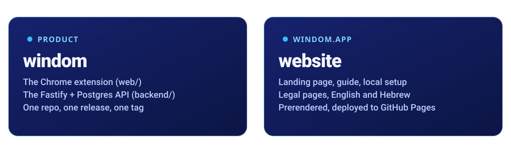

 

**Your clock, the weather, today's tasks, your calendar, what's playing, the pull requests waiting on you
and live market prices — on a background that changes with the hour.**
 Most of it works the moment you install it, with no account.

 

[Install](https://chromewebstore.google.com/detail/windom/comcnbccalbfcegbmaemancbhgpijkpb) ·
[Local setup](https://windom.app/local-setup) ·
[Support](https://windom.app/support) ·
[Privacy](https://windom.app/privacy) ·
[Security](https://github.com/WindoM-app/.github/blob/main/SECURITY.md) ·
[Changelog](https://github.com/WindoM-app/windom/blob/main/CHANGELOG.md)

Free and open source under the MIT licence. Built by [Yehuda Briskman](https://yehudabriskman.com).

